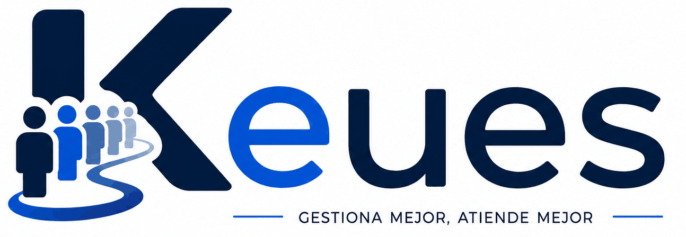

[](README.md) · [](README_EN.md)

<p align="center">
  
</p>

<p align="center">
  <b>Sistema de gestión de colas y turnos</b> para comercios, clínicas, administraciones públicas y cualquier organización que necesite organizar la atención presencial al cliente.
</p>

<p align="center">
  
  
  
  <br>
  
  
  
  
  
</p>

<p align="center">
  Web oficial y documentación: <b><a href="https://www.keues.dev">https://www.keues.dev</a></b>
</p>

---

## ¿Para quién es Keues?

Keues está pensado para cualquier negocio o institución con atención presencial y varios mostradores o puestos:

- **Comercios de alimentación** — carnicerías, pescaderías, fruterías: el cliente saca un número y espera a ser llamado.
- **Banca, clínicas y administración pública** — gestión de turnos con distintas prioridades y tipos de servicio.
- **Grandes superficies** — puestos sin tickets donde el monitor simplemente avisa de qué caja ha quedado libre.
- **Mercados tradicionales** — el cliente coge un número de papel y el monitor digital muestra a quién están atendiendo.

Todo corre en un único contenedor Docker en tu propia infraestructura. Sin cuotas, sin datos en la nube de terceros, con API abierta.

---

## Tabla de contenidos

- [Tipos de flujo](#tipos-de-flujo)
- [El ciclo de atención](#el-ciclo-de-atención)
- [Ecosistema de aplicaciones](#ecosistema-de-aplicaciones)
- [Características](#características)
- [Instalación](#instalación)
- [Documentación de la API](#documentación-de-la-api)
- [Pruebas](#pruebas)
- [Arquitectura](#arquitectura)
- [Licencia](#licencia)

---

## Tipos de flujo

Cada establecimiento puede tener varios flujos simultáneos según el tipo de atención que ofrezca:

| Tipo | Cuándo usarlo | Cómo funciona |
|---|---|---|
| `TicketMachine` | Carnicería, clínica, banco, farmacia… | El cliente saca un ticket en el terminal y el operador lo llama desde el mostrador |
| `SetFree` | Cajas de supermercado, taquillas, puntos de información | Sin tickets: el operador avisa en pantalla cuando su puesto queda libre |
| `ManualCall` | Mercados con dispensador de papel, pescaderías | El operador sube o baja el número manualmente y el monitor lo muestra en tiempo real |
| `QrVirtual` | Cola virtual con QR rotativo: comercios, clínicas, administración… | El flujo tiene una única cola. La pantalla muestra un QR que rota cada 5 minutos; el cliente lo escanea y obtiene su turno |

> `QrVirtual` está disponible a partir de la versión **1.8.0**.

---

## El ciclo de atención

**1. El cliente saca su turno**
Se acerca al terminal de autoservicio (TicketMachine), elige el servicio que necesita navegando por el menú configurado por el administrador y recibe su código de turno (p. ej. `C-004`).

**2. El operador llama al siguiente**
Cuando termina con un cliente, pulsa "Llamar siguiente" en su puesto (Counter). El sistema selecciona automáticamente el ticket más adecuado según la prioridad de las colas, el tiempo de espera acumulado y el ratio de atención configurado.

**3. Los monitores se actualizan al instante**
Las pantallas visibles para los clientes (Monitors) muestran el turno llamado y el puesto al que debe dirigirse el cliente, sin recargar la página y sin delay apreciable.

**4. El operador cierra el turno**
Al terminar la atención, marca el ticket como atendido. El mostrador queda libre para el siguiente ciclo.

---

## Ecosistema de aplicaciones

Keues se compone de cuatro aplicaciones que trabajan juntas:

| Aplicación | Quién la usa | Qué hace |
|---|---|---|
| [**Keues**](https://github.com/HastaCs/Keues) *(este repo)* | Administrador | API central + dashboard web de configuración y seguimiento |
| [**Keues-Counter**](https://github.com/HastaCs/Keues-Counter) | Operador del mostrador | Llama el siguiente turno, marca tickets como atendidos o libera el puesto |
| [**Keues-Monitors**](https://github.com/HastaCs/Keues-Monitors) | Pantallas visibles al cliente | Muestra el turno actual y el mostrador al que debe ir el cliente |
| [**Keues-TicketMachine**](https://github.com/HastaCs/Keues-TicketMachine) | Cliente (kiosco táctil) | Muestra el menú de servicios y entrega el número de turno |

---

## Características

### Múltiples establecimientos
Gestiona varios locales desde un único sistema. Cada establecimiento tiene sus propias colas, mostradores, flujos y dispositivos, completamente independientes.

### Colas inteligentes
El algoritmo de selección del siguiente turno combina tres mecanismos:

- **Prioridad** — las colas con mayor prioridad se atienden antes. Útil para separar urgencias de citas programadas, o clientes VIP de cola general.
- **Peso** — cuando varias colas tienen la misma prioridad, el peso define el ratio de atención entre ellas. Un peso de 3:1 entre la cola A y la B significa que se atienden 3 tickets de A por cada 1 de B.
- **Envejecimiento (aging)** — cada X minutos que un ticket lleva esperando, sube automáticamente un punto de prioridad, evitando que nadie espere indefinidamente aunque su cola tenga menor prioridad base.

### Dashboard de administración
Panel web con seguimiento de cada establecimiento:

- KPIs del día: tickets en espera, en atención, atendidos y cancelados.
- Tiempo medio de espera y tiempo medio de servicio.
- Vista de qué mostrador está atendiendo qué turno y desde cuándo.
- Tickets esperando por cola ordenados por antigüedad.
- Historial completo con filtros por estado, cola, rango de fechas y búsqueda libre.

### Configuración sin límites
- **Menú de la TicketMachine** configurable como árbol de categorías y servicios, con icono y color por nodo.
- **Numeración por cola** con prefijo personalizable (ej: `C`, `P`, `M`) y valor máximo configurable.
- **Mostradores especializados** — cada mostrador puede estar autorizado a atender solo determinadas colas.
- **Colores** para colas y mostradores, visibles en el dashboard y en los monitores.

### Cola virtual por QR
Un flujo QR tiene una única cola asociada. La pantalla del cliente muestra un QR que rota cada 5 minutos; el cliente lo escanea y obtiene su turno. La página pública del QR se sirve en el puerto `8081`, separada del dashboard y la API interna del `8080`.

### Tiempo real sin esfuerzo
Los monitores y mostradores reciben los cambios al instante. Sin recargar. Sin polling.

### Multi-idioma y tema
Interfaz disponible en **español e inglés**. Toggle de **tema claro/oscuro** en la barra superior.

### Seguridad y acceso
- Primer arranque guiado: el sistema detecta que no hay administrador y lo crea paso a paso.
- Autenticación con JWT en cookie HttpOnly.
- Recuperación de contraseña por email (SMTP o Mailjet configurables).
- Separación de puertos: `8080` para administración y API completa; `8081` solo para la página pública del QR y sus endpoints.

### Despliegue sencillo
Un solo contenedor Docker. Los datos persisten en un volumen local. Sin base de datos externa, sin servicios adicionales.

---

## Instalación

### Docker (recomendado)

```bash
docker run -d \
  --name keues \
  -p 8080:8080 \
  -p 8081:8081 \
  -e KEUES_QR_URL="http://TU_IP:8081" \
  -v "$(pwd)/data:/app/data" \
  gorerecord/keues:latest
```

Abre **http://localhost:8080**: en el primer arranque el dashboard te guiará para crear el primer administrador.

- `8080` es el dashboard y la API completa. **No lo expongas a Internet.**
- `8081` es la página pública del QR. Es el único puerto que necesitan los clientes.
- `KEUES_QR_URL` es opcional: solo se necesita si usas cola virtual QR, y debe ser una URL alcanzable desde el móvil del cliente. `localhost` no sirve para un teléfono.
- `KEUES_DASHBOARD_URL` es opcional: se usa principalmente para los enlaces de recuperación de contraseña y como fallback del QR si no hay URL específica.

O con Docker Compose:

```yaml
services:
  keues:
    image: gorerecord/keues:latest
    container_name: keues
    ports:
      # Dashboard/API interna. Mantener privada o protegida por firewall.
      - "8080:8080"
      # Página pública del QR. Es el único puerto que deben alcanzar los clientes.
      - "8081:8081"
    volumes:
      - ./data:/app/data
    environment:
      KEUES_DASHBOARD_URL: "http://TU_IP:8080"
      KEUES_QR_URL: "http://TU_IP:8081"
    restart: unless-stopped
```

### Cola virtual por QR

Los dos puertos solo son necesarios si usas cola virtual QR. Si no la usas, publica solo el `8080`; el `8081` puede quedar sin publicar y `KEUES_QR_URL` puede quedar vacío. El contenedor sigue escuchando en `8081` internamente, pero no es accesible desde fuera si no publicas ese puerto.

El `8081` es una medida de seguridad: permite publicar solo la página del QR y sus endpoints, manteniendo el dashboard, la administración y la API completa en el `8080` privado.

Para la URL del QR, `KEUES_QR_URL` tiene prioridad sobre `keuesQrUrl`. Si la variable está vacía, se usa `keuesQrUrl` del `config.json`.

En una LAN, el QR apunta a:

```text
http://192.168.1.50:8081/turno/{flowId}/{token}
```

El dashboard y la API completa siguen en:

```text
http://192.168.1.50:8080
```

Si hay una WiFi de clientes, el `8080` no debe ser accesible desde ella. La TicketMachine debe estar en la red de confianza.

Para exponerlo a Internet, publica **solo el 8081** detrás de HTTPS:

- Nginx, Traefik o Caddy apuntando a `http://keues:8081`.
- Cloudflare Tunnel apuntando a `http://keues:8081`.
- ngrok solo para pruebas.

No expongas el `8080` a Internet. El `8081` solo permite la página del QR, sus assets y los endpoints necesarios (`/api/flows/{id}`, `/api/queues/{id}/qr-new-ticket`, `/api/tickets/{id}`); todo lo demás devuelve `404`.

Se recomienda limitar peticiones en el proxy para `/api/queues/*/qr-new-ticket`.

Si publicas el contenedor como `8090:8081`, el proxy debe apuntar a `http://127.0.0.1:8090` y `KEUES_QR_URL` debe ser la URL pública final, por ejemplo `https://www.miweb.com`. El puerto interno del contenedor sigue siendo `8081`; el puerto externo puede ser distinto.

### Desarrollo local

Requisitos: **.NET 10 SDK** y **Node.js + pnpm**.

```bash
# API
dotnet run --project Keues.API
# → http://localhost:5125

# Dashboard
cd Keues.Dashboard
pnpm install
pnpm dev
```

> El proxy de Vite apunta a `http://localhost:5125`. Si lanzas la API en otro puerto, ajusta `Keues.Dashboard/vite.config.mjs`.

---

## Documentación de la API

OpenAPI disponible en `http://localhost:5125/openapi/v1.json` durante el desarrollo. Para regenerar `docs/openapi.json`:

```bash
./scripts/export-openapi.sh
```

---

## Pruebas

```bash
dotnet test Keues.Tests
```

La suite cubre los casos de uso (numeración, prioridad, aging, peso, autenticación) y la API completa con integración HTTP real.

---

<details>
<summary><b>Arquitectura interna</b></summary>

```
┌──────────────────────────────────────────────────────────┐
│  Keues.Dashboard   SPA React (administración web)        │
├──────────────────────────────────────────────────────────┤
│  Keues.API         Endpoints HTTP + hub tiempo real      │
├──────────────────────────────────────────────────────────┤
│  Keues.Application Casos de uso                          │
├──────────────────────────────────────────────────────────┤
│  Keues.Domain      Entidades y reglas de negocio         │
├──────────────────────────────────────────────────────────┤
│  Keues.Infrastructure  EF Core · SQLite · JWT · SMTP     │
└──────────────────────────────────────────────────────────┘
```

Tecnologías: ASP.NET Core (.NET 10), Entity Framework Core + SQLite, SignalR, JWT, React 19 + TypeScript + Vite 8 + Mantine 9, xUnit, Docker.

</details>

---

## Licencia

Este proyecto se distribuye bajo la licencia **MIT**. Consulta el archivo [LICENSE](LICENSE).

---

Hecho con 💙 por [HastaCs](https://github.com/HastaCs).
