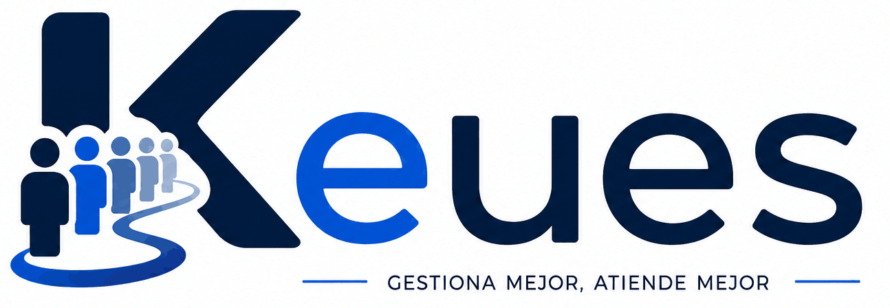

[](README_EN.md) · [](README.md)

<p align="center">
  
</p>

<p align="center">
  <b>Queue and turn management system</b> for shops, clinics, public administrations and any organization that needs to organize in-person customer service.
</p>

<p align="center">
  
  
  
  <br>
  
  
  
  
  
</p>

<p align="center">
  Official website and documentation: <b><a href="https://www.keues.dev">https://www.keues.dev</a></b>
</p>

---

## Who is Keues for?

Keues is designed for any business or institution with in-person service and multiple counters or desks:

- **Food shops** — butchers, fishmongers, greengrocers: the customer takes a number and waits to be called.
- **Banking, clinics and public administration** — turn management with different priorities and service types.
- **Large stores** — desks without tickets where the monitor simply shows which checkout has just become free.
- **Traditional markets** — the customer takes a paper number and the digital monitor shows who is currently being served.

Everything runs in a single Docker container on your own infrastructure. No subscriptions, no data in third-party clouds, open API.

---

## Table of contents

- [The service cycle](#the-service-cycle)
- [Application ecosystem](#application-ecosystem)
- [Flow types](#flow-types)
- [Features](#features)
- [Installation](#installation)
- [API documentation](#api-documentation)
- [Testing](#testing)
- [Architecture](#architecture)
- [License](#license)

---

## The service cycle

**1. The customer takes their turn**
They approach the self-service terminal (TicketMachine), choose the service they need by navigating through the menu configured by the administrator, and receive their turn code (e.g. `C-004`).

**2. The operator calls the next one**
When finished with a customer, they press "Call next" at their desk (Counter). The system automatically selects the most suitable ticket based on queue priority, accumulated waiting time and the configured attention ratio.

**3. Monitors update instantly**
The screens visible to customers (Monitors) show the called turn and the desk the customer should go to, without reloading the page and with no noticeable delay.

**4. The operator closes the turn**
When the service is complete, they mark the ticket as attended. The desk is free for the next cycle.

---

## Application ecosystem

Keues is made up of four applications that work together:

| Application | Who uses it | What it does |
|---|---|---|
| [**Keues**](https://github.com/HastaCs/Keues) *(this repo)* | Administrator | Central API + web dashboard for configuration and monitoring |
| [**Keues-Counter**](https://github.com/HastaCs/Keues-Counter) | Desk operator | Calls the next turn, marks tickets as attended or frees the desk |
| [**Keues-Monitors**](https://github.com/HastaCs/Keues-Monitors) | Customer-facing screens | Shows the current turn and the desk the customer should go to |
| [**Keues-TicketMachine**](https://github.com/HastaCs/Keues-TicketMachine) | Customer (touch kiosk) | Shows the service menu and delivers the turn number |

---

## Flow types

Each location can have several simultaneous flows depending on the type of service it offers:

| Type | When to use it | How it works |
|---|---|---|
| `TicketMachine` | Butcher, clinic, bank, pharmacy… | The customer takes a ticket at the terminal and the operator calls them from the desk |
| `SetFree` | Supermarket checkouts, ticket offices, information points | No tickets: the operator notifies the screen when their desk is free |
| `ManualCall` | Markets with paper dispensers, fishmongers | The operator moves the number up or down manually and the monitor shows it in real time |

---

## Features

### Multiple locations
Manage several establishments from a single system. Each location has its own queues, counters, flows and devices, completely independent from one another.

### Smart queues
The next-turn selection algorithm combines three mechanisms:

- **Priority** — queues with higher priority are served first. Useful for separating urgent cases from scheduled appointments, or VIP customers from the general queue.
- **Weight** — when several queues share the same priority, weight defines the service ratio between them. A 3:1 weight between queue A and queue B means 3 tickets from A are served for every 1 from B.
- **Aging** — every X minutes a ticket has been waiting, its priority automatically rises by one point, preventing anyone from waiting indefinitely even if their queue has a lower base priority.

### Administration dashboard
Web panel with monitoring for each location:

- Daily KPIs: tickets waiting, in service, attended and cancelled.
- Average waiting time and average service time.
- View of which desk is serving which turn and since when.
- Tickets waiting per queue ordered by age.
- Full history with filters by status, queue, date range and free-text search.

### Unlimited configuration
- **TicketMachine menu** configurable as a tree of categories and services, with icon and colour per node.
- **Per-queue numbering** with a customisable prefix (e.g. `C`, `P`, `M`) and configurable maximum value.
- **Specialised desks** — each counter can be authorised to serve only certain queues.
- **Colours** for queues and counters, visible in the dashboard and on monitors.

### QR virtual queue
A QR flow has exactly one associated queue. The customer-facing screen shows a QR code that rotates every 5 minutes; the customer scans it and gets a ticket. The public QR page is served on port `8081`, separately from the admin dashboard and internal API on `8080`.

### Real time with no effort
Monitors and counters receive changes instantly. No reloading. No polling.

### Multi-language and theme
Interface available in **English and Spanish**. **Light/dark theme** toggle in the top bar.

### Security and access
- Guided first launch: the system detects there is no administrator and creates one step by step.
- JWT authentication in an HttpOnly cookie.
- Password recovery by email (configurable SMTP or Mailjet).
- Port separation: `8080` for administration and the full API; `8081` only for the public QR page and its endpoints.

### Simple deployment
A single Docker container. Data persists in a local volume. No external database, no additional services.

---

## Installation

### Docker (recommended)

```bash
docker run -d \
  --name keues \
  -p 8080:8080 \
  -p 8081:8081 \
  -e KEUES_QR_URL="http://YOUR_HOST_IP:8081" \
  -v "$(pwd)/data:/app/data" \
  gorerecord/keues:latest
```

Open **http://localhost:8080**: on first launch the dashboard will guide you through creating the first administrator.

- `8080` is the dashboard and full API. **Do not expose it to the Internet.**
- `8081` is the public QR page. It is the only port customers need.
- `KEUES_QR_URL` must be reachable from the customer's phone. `localhost` will not work for a phone.

Or with Docker Compose:

```yaml
services:
  keues:
    image: gorerecord/keues:latest
    container_name: keues
    ports:
      # Admin/internal API. Keep private or firewall it.
      - "8080:8080"
      # Public QR page. This is the only port customers need.
      - "8081:8081"
    volumes:
      - ./data:/app/data
    environment:
      KEUES_DASHBOARD_URL: "http://YOUR_HOST_IP:8080"
      KEUES_QR_URL: "http://YOUR_HOST_IP:8081"
      KEUES_PUBLIC_PORT: "8081"
    restart: unless-stopped
```

### QR virtual queue

Both ports are only needed if you use the QR virtual queue. If you do not use QR, publish only `8080`; `8081` can stay unpublished. The container still listens on `8081` internally, but it is not reachable from outside unless you publish that port.

Port `8081` is a security boundary: it publishes only the QR page and its endpoints, keeping the dashboard, administration and full API on the private `8080`.

On a LAN the QR points to:

```text
http://192.168.1.50:8081/turno/{flowId}/{token}
```

The dashboard and full API remain on:

```text
http://192.168.1.50:8080
```

If there is a customer WiFi, `8080` must not be reachable from it. The TicketMachine must be on the trusted network.

To expose it to the Internet, publish **only port 8081** behind HTTPS:

- Nginx, Traefik or Caddy pointing to `http://keues:8081`.
- Cloudflare Tunnel pointing to `http://keues:8081`.
- ngrok for testing only.

Do not expose `8080` to the Internet. Port `8081` only allows the QR page, its assets and the required endpoints (`/api/flows/{id}`, `/api/queues/{id}/qr-new-ticket`, `/api/tickets/{id}`); everything else returns `404`.

Rate limiting `/api/queues/*/qr-new-ticket` at the proxy is recommended.

### Local development

Requirements: **.NET 10 SDK** and **Node.js + pnpm**.

```bash
# API
dotnet run --project Keues.API
# → http://localhost:5125

# Dashboard
cd Keues.Dashboard
pnpm install
pnpm dev
```

> The Vite proxy points to `http://localhost:5125`. If you run the API on a different port, adjust `Keues.Dashboard/vite.config.mjs`.

---

## API documentation

OpenAPI available at `http://localhost:5125/openapi/v1.json` during development. To regenerate `docs/openapi.json`:

```bash
./scripts/export-openapi.sh
```

---

## Testing

```bash
dotnet test Keues.Tests
```

The suite covers the use cases (numbering, priority, aging, weight, authentication) and the full API with real HTTP integration.

---

<details>
<summary><b>Internal architecture</b></summary>

```
┌──────────────────────────────────────────────────────────┐
│  Keues.Dashboard   React SPA (web administration)        │
├──────────────────────────────────────────────────────────┤
│  Keues.API         HTTP endpoints + real-time hub        │
├──────────────────────────────────────────────────────────┤
│  Keues.Application Use cases                             │
├──────────────────────────────────────────────────────────┤
│  Keues.Domain      Entities and business rules           │
├──────────────────────────────────────────────────────────┤
│  Keues.Infrastructure  EF Core · SQLite · JWT · SMTP     │
└──────────────────────────────────────────────────────────┘
```

Technologies: ASP.NET Core (.NET 10), Entity Framework Core + SQLite, SignalR, JWT, React 19 + TypeScript + Vite 8 + Mantine 9, xUnit, Docker.

</details>

---

## License

This project is released under the **MIT License**. See the [LICENSE](LICENSE) file.

---

Made with 💙 by [HastaCs](https://github.com/HastaCs).
